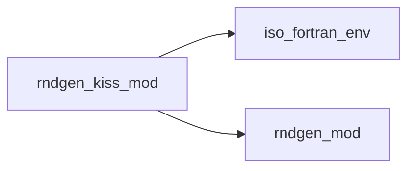
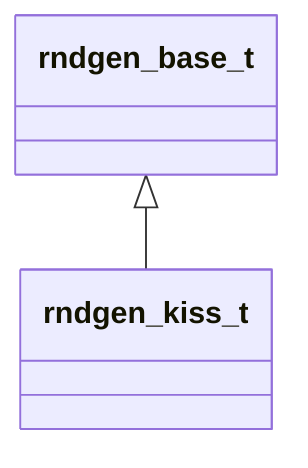

# rndgen_kiss_mod

**Source**: `src/rndgen_kiss_mod.f90`

**Dependencies**

## Contents

- [rndgen_kiss_t](#rndgen-kiss-t)

## Derived Types

### rndgen_kiss_t

**Inheritance**

**Extends**: [`rndgen_base_t`](/api/rndgen_mod#rndgen-base-t)

#### Components

| Name | Type | Attributes | Description |
|------|------|------------|-------------|
| `oseed` | integer(kind=i4) |  |  |

#### Type-Bound Procedures

| Name | Attributes | Description |
|------|------------|-------------|
| `init` |  |  |
| `rnd_sp` |  |  |
| `rnd` |  |  |
| `int` |  |  |
| `real` |  |  |
| `bool` |  |  |
| `fill_array` |  |  |
| `rnd_array` |  |  |
| `bool_array` |  |  |
| `init_i4` |  |  |
| `init_i8` |  |  |
| `reset` |  |  |
| `next_integer` |  |  |
| `get_state` |  |  |
| `set_state` |  |  |
| `rnd_dp` |  |  |
