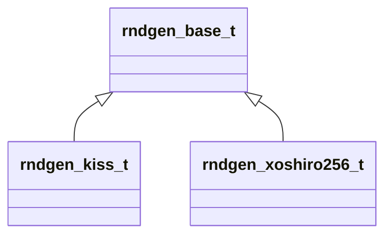
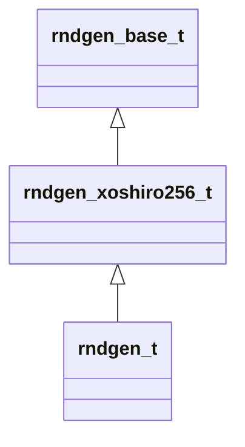
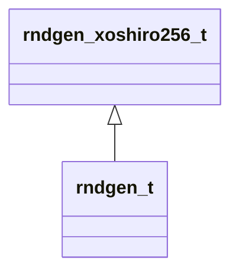

# rndgen_mod

**Source**: `src/rndgen_mod.f90`

**Dependencies**

## Contents

- [rndgen_state_t](#rndgen-state-t)
- [rndgen_base_t](#rndgen-base-t)
- [rndgen_xoshiro256_t](#rndgen-xoshiro256-t)
- [rndgen_t](#rndgen-t)

## Derived Types

### rndgen_state_t

Container for seeds IO

#### Components

| Name | Type | Attributes | Description |
|------|------|------------|-------------|
| `data` | integer(kind=i8) |  |  |

#### Type-Bound Procedures

| Name | Attributes | Description |
|------|------------|-------------|
| `save_state` |  |  |
| `read_state` |  |  |

### rndgen_base_t

Abstract random generator type. This is the base type for all random number generators.

**Inheritance**

**Attributes**: abstract

#### Type-Bound Procedures

| Name | Attributes | Description |
|------|------------|-------------|
| `init_i4` | pass(this) |  |
| `init_i8` | pass(this) |  |
| `init` |  |  |
| `reset` | pass(this) |  |
| `next_integer` | pass(this) |  |
| `get_state` | pass(this) |  |
| `set_state` | pass(this) |  |
| `rnd_dp` | pass(this) |  |
| `rnd_sp` |  |  |
| `rnd` |  |  |
| `int` |  |  |
| `real` |  |  |
| `bool` |  |  |
| `fill_array` |  |  |
| `rnd_array` |  |  |
| `bool_array` |  |  |

### rndgen_xoshiro256_t

**Inheritance**

**Extends**: [`rndgen_base_t`](/api/rndgen_mod#rndgen-base-t)

#### Components

| Name | Type | Attributes | Description |
|------|------|------------|-------------|
| `oseed` | integer(kind=i8) |  |  |

#### Type-Bound Procedures

| Name | Attributes | Description |
|------|------------|-------------|
| `init` |  |  |
| `rnd_sp` |  |  |
| `rnd` |  |  |
| `int` |  |  |
| `real` |  |  |
| `bool` |  |  |
| `fill_array` |  |  |
| `rnd_array` |  |  |
| `bool_array` |  |  |
| `init_i4` |  |  |
| `init_i8` |  |  |
| `reset` |  |  |
| `next_integer` |  |  |
| `get_state` |  |  |
| `set_state` |  |  |
| `rnd_dp` |  |  |
| `jump` |  |  |
| `long_jump` |  |  |

### rndgen_t

**Inheritance**

**Extends**: [`rndgen_xoshiro256_t`](/api/rndgen_mod#rndgen-xoshiro256-t)

#### Components

| Name | Type | Attributes | Description |
|------|------|------------|-------------|
| `oseed` | integer(kind=i8) |  |  |

#### Type-Bound Procedures

| Name | Attributes | Description |
|------|------------|-------------|
| `init` |  |  |
| `rnd_sp` |  |  |
| `rnd` |  |  |
| `int` |  |  |
| `real` |  |  |
| `bool` |  |  |
| `fill_array` |  |  |
| `rnd_array` |  |  |
| `bool_array` |  |  |
| `init_i4` |  |  |
| `init_i8` |  |  |
| `reset` |  |  |
| `next_integer` |  |  |
| `get_state` |  |  |
| `set_state` |  |  |
| `rnd_dp` |  |  |
| `jump` |  |  |
| `long_jump` |  |  |
