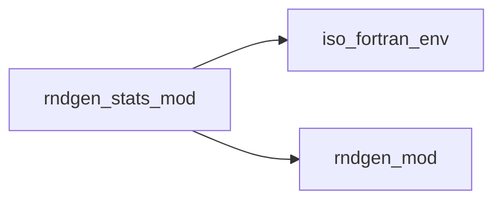
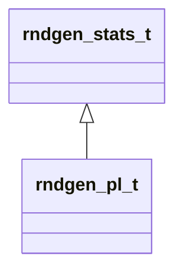

# rndgen_stats_mod

**Source**: `src/rndgen_stats_mod.f90`

**Dependencies**

## Contents

- [rndgen_stats_t](#rndgen-stats-t)

## Derived Types

### rndgen_stats_t

**Inheritance**

#### Components

| Name | Type | Attributes | Description |
|------|------|------------|-------------|
| `rng` | class([rndgen_base_t](/api/rndgen_mod#rndgen-base-t)) | allocatable |  |

#### Type-Bound Procedures

| Name | Attributes | Description |
|------|------------|-------------|
| `init` |  |  |
