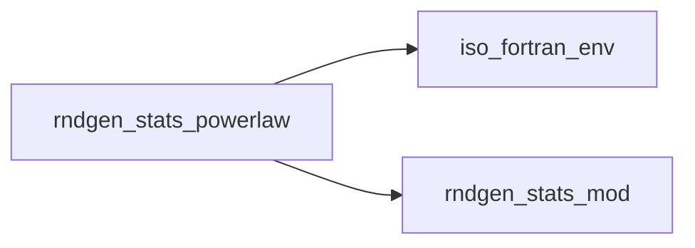
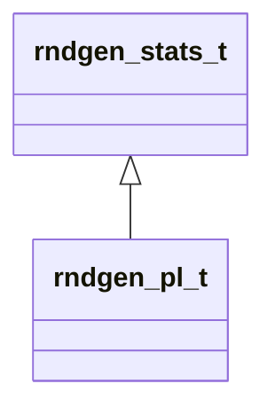

# rndgen_stats_powerlaw

**Source**: `src/rndgen_stats/rndgen_stats_powerlaw.f90`

**Dependencies**

## Contents

- [rndgen_pl_t](#rndgen-pl-t)

## Derived Types

### rndgen_pl_t

**Inheritance**

**Extends**: [`rndgen_stats_t`](/api/rndgen_stats_mod#rndgen-stats-t)

#### Components

| Name | Type | Attributes | Description |
|------|------|------------|-------------|
| `rng` | class([rndgen_base_t](/api/rndgen_mod#rndgen-base-t)) | allocatable |  |
| `pl_gamma` | real(kind=dp) |  |  |
| `pl_kmin` | integer(kind=i4) |  |  |
| `pl_kmax` | integer(kind=i4) |  |  |

#### Type-Bound Procedures

| Name | Attributes | Description |
|------|------------|-------------|
| `init` |  |  |
| `init_powerlaw` |  |  |
| `rndPL` |  |  |
| `rndPL_array` |  |  |
