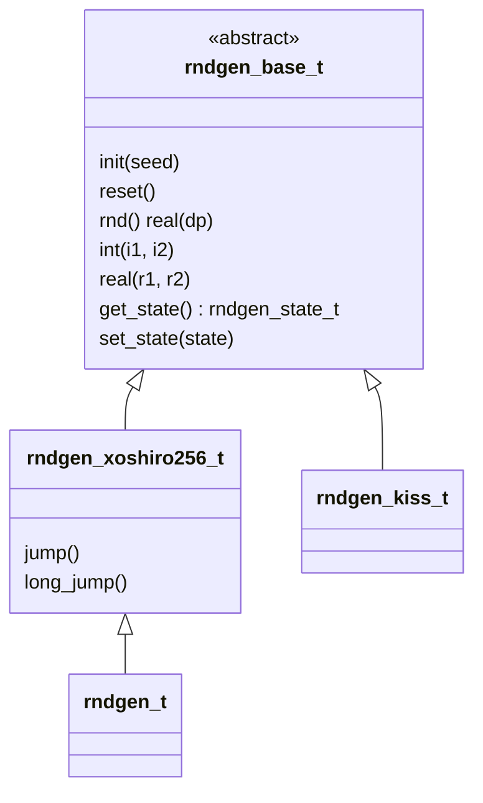

# Getting Started

`rndgen-fortran` is a modern Fortran random-number library centered on **xoshiro256\*\*** as the default generator.

- Original C reference implementation (public domain / CC0):
  <https://prng.di.unimi.it/xoshiro256starstar.c>
- This Fortran implementation is adapted from
  [fortran-lang/stdlib](https://github.com/fortran-lang/stdlib).
- Background and benchmarks: <https://prng.di.unimi.it/>

## Why xoshiro256\*\*

- 256-bit internal state
- Long period: $2^{256}-1$
- Excellent speed and statistical quality for general scientific use
- Widespread adoption in modern runtimes and toolchains

## Installation via fpm

Add this dependency to your `fpm.toml`:

```toml
[dependencies]
rndgen-fortran = { git = "https://github.com/wcota/rndgen-fortran", tag = "v2.0.0" }
```

## Quick Start

```fortran
program demo_rndgen
    use iso_fortran_env, only : i4 => int32, i8 => int64, sp => real32, dp => real64
    use rndgen_mod, only : rndgen_t
    implicit none

    type(rndgen_t) :: rng
    call rng%init(42)  ! default integer (typically i4); i8 also works if needed

    print *, rng%rnd()                    ! real(dp) in [0, 1)
    print *, rng%int(1, 10)               ! default integer range; use i4/i8 explicitly if needed
    print *, rng%real(-1.0_dp, 1.0_dp)    ! real(dp) in [-1, 1)
end program demo_rndgen
```

Kind aliases used throughout this documentation:

| Alias | `iso_fortran_env` kind |
|---|---|
| `i4` | `int32` |
| `i8` | `int64` |
| `sp` | `real32` |
| `dp` | `real64` |

## Main Types

| Type | Module | Description |
|---|---|---|
| `rndgen_t` | `rndgen_mod` | Default generator type in v2 (xoshiro256\*\*). |
| `rndgen_xoshiro256_t` | `rndgen_mod` | Explicit xoshiro256\*\* type if you prefer to name the engine. |
| `rndgen_base_t` | `rndgen_mod` | Abstract base class for polymorphic RNG workflows. |
| `rndgen_state_t` | `rndgen_mod` | State container for save/restore operations. |
| `rndgen_kiss_t` | `rndgen_kiss_mod` | Legacy KISS generator, kept for compatibility. |



## Next Steps

1. [**Generating Numbers**](./usage.md): scalars, arrays and in-place filling.
2. [**State & Reproducibility**](./state.md): reset, snapshot, save and restore.
3. [**Parallel Streams**](./parallel.md): `jump` and `long_jump` with OpenMP.
4. [**KISS Compatibility**](./kiss.md): the legacy v1 engine.
5. [**Migrating from v1**](./migrating.md): breaking changes and before/after code.
