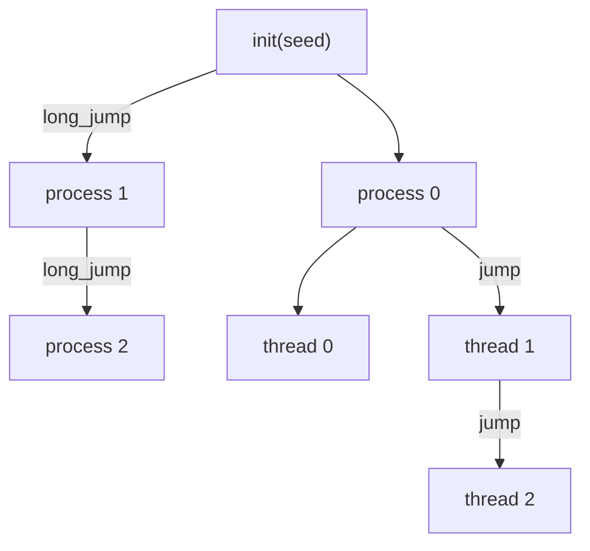

# Parallel Streams

`rndgen_xoshiro256_t` (and therefore `rndgen_t`) exposes two deterministic skip-ahead operations:

| Call | Advances the stream by | Typical use |
|---|---|---|
| `call rng%jump()` | $2^{128}$ steps | one subsequence per thread |
| `call rng%long_jump()` | $2^{192}$ steps | one starting point per process/node |

Each jump costs about 256 calls to the generator, independently of the distance skipped.

## Hybrid Strategy



- `long_jump` partitions by process/node.
- `jump` partitions by thread within each process.

All streams derive from a single seed, so the whole parallel run stays reproducible.

## OpenMP Example

One independent generator per thread:

```fortran
program demo_openmp_jump
    use iso_fortran_env, only : i4 => int32, i8 => int64
    use omp_lib
    use rndgen_mod, only : rndgen_t
    implicit none

    type(rndgen_t) :: master
    type(rndgen_t), allocatable :: rngs(:)
    integer(i4) :: nthreads, tid, i

    call master%init(2026_i8)

    ! 1. Planning (sequential)
    ! Outside the parallel region, use omp_get_max_threads()
    ! to know how many threads will be created.
    nthreads = omp_get_max_threads()
    allocate(rngs(nthreads))

    ! 2. O(N) distribution (sequential)
    ! The master performs the jumps and distributes prepared states.
    ! This costs only one jump per allocated thread.
    do i = 1, nthreads
        rngs(i) = master
        call master%jump()
    end do

    ! 3. Parallel execution
    ! Threads start with a ready-to-use PRNG state,
    ! without extra initialization cost.
    !$omp parallel default(none) shared(rngs) private(tid)
    tid = omp_get_thread_num()

    print *, "thread", tid, "rnd =", rngs(tid + 1)%rnd()
    !$omp end parallel

end program demo_openmp_jump
```

Build with OpenMP enabled (example with `gfortran`):

```bash
gfortran -fopenmp demo_openmp_jump.f90 -o demo_openmp_jump
```
